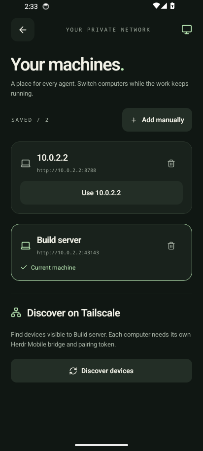
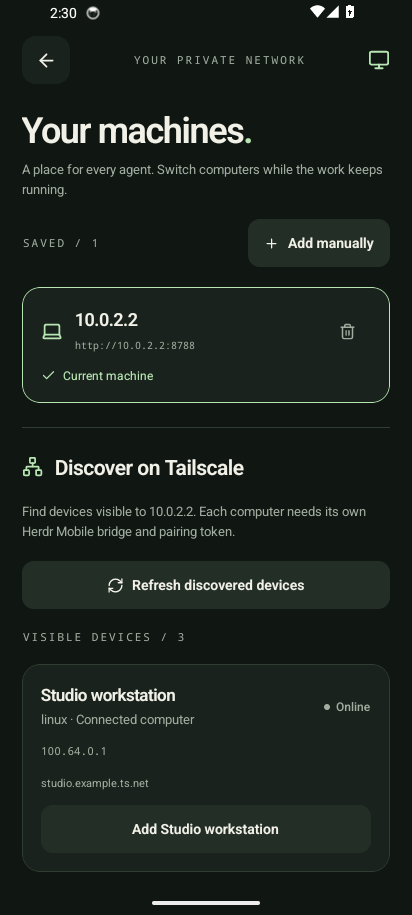
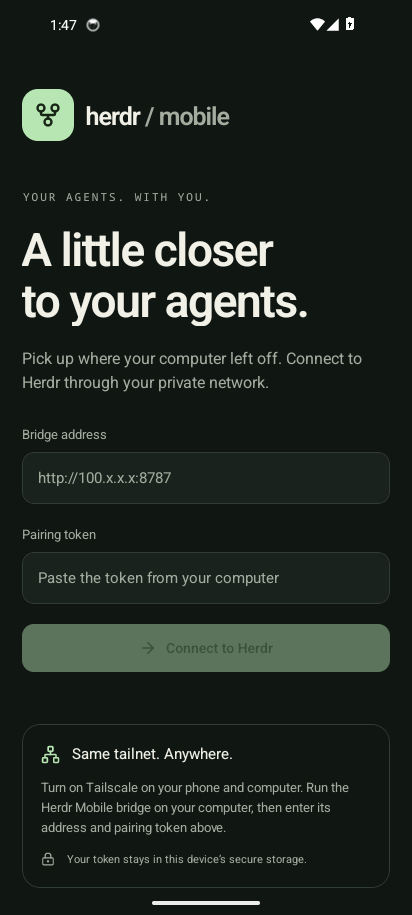
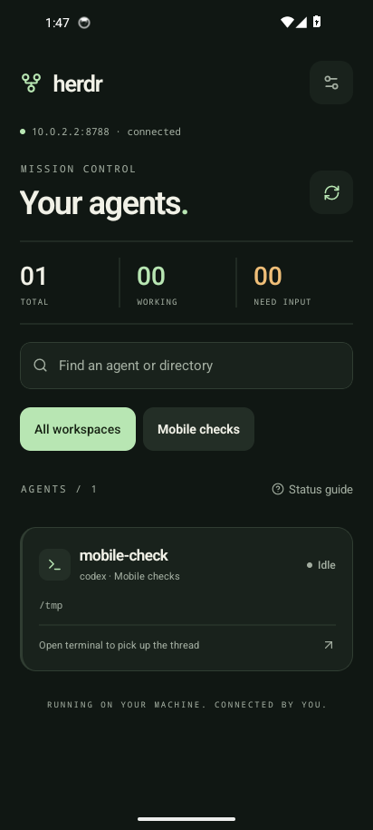
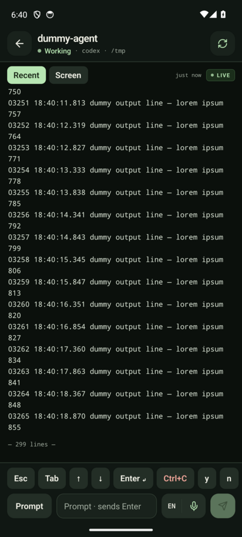

# Verification — October 15, 2026

## Home screen widget — November 4, 2026

- Lint and TypeScript pass. 199 tests pass, including new suites for the widget's grouping, ordering, layout, links and clock (`widget.test.ts`) and the read-only `MachineStore.peek()` (no writes, no v1 migration, the same active-profile fallback as `load()`). The 10 Hermes host tests in `bridge/src/hermes/host.test.ts` time out on this machine's newer Hermes, on `main` as well; the unmerged `fix/hermes-latest` branch addresses that. This change does not touch the bridge.
- Release APK (arm64-v8a + x86_64) installed over 0.5.0 on the read-only `herdr-mobile-test` emulator (Android 14, Pixel launcher, 1080×2400 at 420 dpi). It was paired with a test bridge on `127.0.0.1` backed by a stand-in Herdr socket that answers only `session.snapshot` from an example file (projects `shop` and `blog`, agents in every status) and refuses every other method. No real Herdr session or agent was used.
- **settings → add home screen widget** opened the launcher's prompt, showing the preview, 4×2 and the description. The widget drew needing input first (tinted), then working, then idle, with Herdr's ✓ for done counted as idle.
- Changing statuses while the app was open redrew the widget from the app's polls. With the app's process killed, ↻ read the bridge from the background task (SecureStore and Apollo work there). With the bridge stopped: `offline · last HH:MM` with the agents dimmed when the process still held a snapshot, otherwise `can't reach desktop`. Resizing redrew it (one cell tall on this launcher, about 100 dp, shows the counters only). Nine agents showed five rows and `+4 more`. Forgetting the last machine showed `pair a computer`, and pairing a machine named `desktop` over the same address redrew it with the new name.
- Tapping a row opened that agent on the active machine. Found and fixed: an agent opened from the widget on a cold start has no screen to go back to, so the header's back arrow did nothing (Android's Back key already went home). It now goes home. The first build failed to draw because the widget library has no fragments; fixed and noted in the code.
- Permissions: WorkManager (the widget library's background tasks) adds `WAKE_LOCK`, `ACCESS_NETWORK_STATE` and `RECEIVE_BOOT_COMPLETED`, none shown to the user. `FOREGROUND_SERVICE` is blocked in app.json, because the library uses expedited work only on Android 12+ and never a foreground service.
- Independent review: no credential, crash or storage-behavior findings. Fixed what it found: header and counter heights now grow with the font size (checked at 1.5×, nothing clipped and two rows plus `+3 more`); a read that ends after a machine switch no longer draws the old machine; an `offline` drawn by ↻ is replaced on the app's next successful poll; the header dot is dim, not green, while an older snapshot is redrawn. PRIVACY.md now says the library keeps the last drawn widget image in private storage.
- Not checked on a physical phone, on launchers other than the Pixel launcher, or across Android's 30-minute periodic update.

## Version 0.5.1: full-screen apps and unwrapped terminal text — November 3, 2026

- Reproduced in a disposable Herdr 0.9.4 session with a stand-in that runs on the alternate screen with mouse reporting and Claude's working title: a 300-line `recent` read fails with `agent_not_idle` while working (the user's report), and while idle Herdr harvests history by sending mouse-wheel events to the app (logged by the stand-in), which would scroll a real agent on the desktop at every poll. Full-screen panes report `max_offset_from_bottom: 0` even after earlier shell output.
- After the fix, the same session: the working full-screen stand-in returns its screen, idle reads send it no input, and a shell with 200 lines of history still returns all of them. Lint, TypeScript and 132 tests pass.
- Release APK 0.5.1 (code 6) on the read-only emulator at 1080×2400, 420 dpi: rows from a 120-column pane stay on one line with a `← swipe →` hint, and a swipe pans the whole screen to the ends of the widest rows. The full-screen stand-in shows its screen while working, with no error and no wheel events sent while viewing it.

## Version 0.5.0: plain terminals and the Herdr look — November 3, 2026

- Lint, TypeScript and 129 tests pass (bridge: startTerminal in a project, home workspace created then reused by label whatever its panes' folders, home agent sessions, not-ready shells, unknown projects; app: status marks, composer modes and Run failure notice, project list and old-bridge detection, and a palette guard that rejects color literals outside the theme).
- `npm run integration` against Herdr 0.9.4 in a disposable named server (`/bin/sh`, restricted PATH, temporary home folder): previous checks, plus a terminal tab labelled `terminal` in the workspace folder running a `printf` marker, and two home terminals sharing one `phone` workspace in the temporary home.
- Release APK 0.5.0 (code 5) on a read-only, headless emulator set to 1080×2400 at 420 dpi (the usual test emulator was in use by another session), paired with a test bridge on a disposable session whose PATH held only stand-in agents (verified with `command -v` first) and a fake home folder. Checked: launch is a plain `#171421` screen for about 0.8 s with no logo or fade; first-machine pairing keeps the token field and connect above the keyboard at font scale 1.0 and 1.3; home, machines and the New sheet follow mockup B; long labels and paths truncate on one line at font scale 1.3; New → Home folder → terminal with first command `echo ok-from-phone` ran it; Run executed `echo ran-42` while Type left text at the prompt; the key row is one sideways-scrolling line; running the stand-in `claude` by hand switched the screen to Prompt; a second home terminal reused the single `phone` workspace, which the project list hides.
- Against the 0.4.0 bridge build: projects still load and an agent session in a project starts (stand-in claude opened in Prompt); Home folder and terminal show the update message with the button disabled. A test now validates every app operation against a frozen 0.4.0 schema after the final review caught a widened `$workspaceId` that 0.4.0 rejected.
- Failed start (`gemini` not on PATH) → **Open the new terminal** shows `gemini: not found` with the typed task kept in Type mode, so it cannot run as a shell command.
- Not checked on a physical phone.

## Version 0.4.0: new sessions and home UX — November 2, 2026

- Lint, TypeScript and 86 tests pass (bridge startSession: project folder, unfocused labelled tab, shell wait, readiness, blocked/exited/missing agents, duplicate names, optional checks; app helpers for kinds, names, ordering, titles and draft handoff).
- `npm run integration` against Herdr 0.9.4 in a disposable named server: a `/bin/sh` startup script that runs a child for one second, a stand-in `codex` verified to be what runs, then startSession → new tab in the workspace folder with the agent name as label → `ready: true` → first task echoed by the stand-in.
- Release APK 0.4.0 (code 4) on the `herdr-mobile-test` emulator, paired with an isolated test bridge on a disposable session (stand-in claude/codex only; system-only PATH, so no real agent CLI could start). Checked: Herd Remote branding; needs-input agent listed first; compact cards with terminal titles; counters as filters; New session → project list → Claude preselected for a Claude project → generated name → first task → the terminal opened with the task delivered; the new tab stayed unfocused and the existing agent was untouched; the sheet stays above the keyboard; the button clears the navigation bar.
- Missing CLI (`gemini` not on PATH): the bridge reports "exited right after launching" in about 3 s with the opened pane; the sheet offers **Open the new terminal**, which shows `gemini: not found` with the typed task kept as the draft.
- Not checked on a physical phone or against the real Claude/Codex CLIs: their readiness timing comes from Herdr's own detection, which the stand-ins only approximate.

## Version 0.3.0: terminal reading, keyboard and dictation

- Lint, TypeScript and 63 tests pass, including new suites for paused-output line counting (`terminal.ts`) and dictation text/language helpers (`dictation.ts`). Expo Doctor: 20/21; the config-schema check could not reach exp.host from this machine.
- Release APK (arm64-v8a + x86_64) installed over the previous build on the `herdr-mobile-test` emulator, paired with a disposable named Herdr session and its own test bridge. A dummy "codex" process printed a line every 0.5s; no prompts or keys were sent and no AI provider was called.
- Reading while working: scrolling up showed PAUSED; the visible lines stayed identical across polls while the pill counted new lines accurately. The pill and swiping to the bottom both resumed LIVE following. Recent/Screen switching reset to the latest output.
- Keyboard: with edge-to-edge Android, `padding` placed the composer and key row directly above the keyboard (no nav-bar gap) in Prompt and Type modes; the header and last terminal lines stayed visible, and no padding remained after dismissal.
- Dictation: microphone permission prompt, remembered EN/PT choice, listening state and stop all worked. The emulator's engine reported only `en-US` installed and no `pt-BR` support, which produced the unsupported-language message. A user stop that Android reports as a client error is now silent. Actual speech transcription in English and pt-BR still needs a physical-phone check.

## Version 0.2.0: Tailscale machines

- Lint, TypeScript and the complete automated suite pass: 49 tests. Coverage now includes safe Tailscale field projection, offline/self peers, invalid inventories, caching and CLI failure handling; authentication before discovery; per-profile credentials, origin deduplication, v1 migration, byte/count limits, interrupted saves/removals and serialized writes.
- Expo Doctor: 21/21 checks from the mobile workspace.
- Local live discovery and the updated bridge query returned the expected visible devices. Only the declared peer fields were returned; no other machine was contacted or controlled.
- Built Android version 0.2.0 / code 2. Its signing certificate matches 0.1.0.
- Installed over the existing 0.1.0 emulator app without clearing data. The saved v1 connection migrated and connected without re-entering a token.
- Native discovery displayed three isolated test devices, including an offline peer. Selecting a peer prefilled its private address.
- Added a second local test bridge with a different token; the app verified it, saved it and selected it.
- Both test bridges intentionally exposed `w1:p1`. The app loaded only Build output on one host and Studio output after switching back. Saved-profile removal preserved the remaining host, and force-stop/relaunch retained the selection.
- Independent review found one migration edge for long hostnames; a regression test failed before the generated-display-name fix and passed afterward.
- Android system Back initially exited from a detail screen. Disabled predictive-back mode for this stack and added a focused home-back handler. The final installed APK passed hardware Back checks from agent detail and Machines, and removal of the last profile returned to initial pairing.

All native multi-host checks use controlled local fixtures. Physical phone connectivity to other tailnet hosts remains a device setup check. Each actual host requires its own bridge/token and a phone-accessible tailnet ACL.

## Version 0.1.0 baseline

- `npm run lint:fix`, `npm run typecheck`, `npm test`, `npm run format:check`: passed. 25 automated tests across socket transport, authenticated GraphQL and connection validation.
- Repeated TypeScript/tests/live integration under Node 22.23.3: passed.
- `npx expo-doctor`: 21/21 checks passed after pinning/deduplicating React and Expo-compatible native peers.
- `npm run export:android -w mobile`: Android Hermes bundle exported successfully.
- Live GraphQL integration against installed Herdr 0.9.4 / protocol 22: a uniquely named disposable server accepted snapshot, literal terminal text, Enter, and returned the expected output. The integration script stops only its own server.
- `ANDROID_ARCHITECTURES=arm64-v8a,x86_64 npm run build:android`: successful, 879 Gradle tasks. Standalone APK: `artifacts/herdr-mobile.apk`, approximately 65 MiB.
- Android package `dev.herdr.mobile`, version 0.1.0, min API 24, target API 36; APK signature verified with apksigner.
- Installed and launched the release-mode APK on an Android 14 emulator at phone dimensions. No React Native JS or Android Runtime errors were logged.
- Native app paired with an authenticated localhost test bridge through the emulator host interface; it listed the test agent and loaded terminal output.
- Submitted a prompt through the actual app, observed its delivery acknowledgment and the echoed reply through Herdr's agent API.
- Force-stop/relaunch restored the connection from Expo SecureStore.
- Stopping the test bridge displayed an offline banner while retaining readable output. Restart + refresh recovered current output.
- No prompts, keys, startup actions or shutdown requests were sent to the user's existing agents. The test agent was a controlled echo process recognized as codex in a separate test session; no real AI provider was called.

The host's real bridge is available through its Tailscale interface. Physical-phone installation and reachability through the phone's tailnet were not tested. The phone must have Tailscale enabled and permission to reach TCP 8787.

Independent review found no critical or important issues. Two minor polling observations are recorded in [review.md](review.md).

## Screenshots

These screenshots contain only the isolated test environment.

| Connect                        | Agents                       | Terminal                      |
| ------------------------------ | ---------------------------- | ----------------------------- |
|  |  |  |

## Hermes coordinator chat (0.6.0)

- Automated: 179 tests (bridge Hermes host against a scripted fake OpenAI-compatible model: exactly four tools, tool relay and streaming, stop + closed request in history, session reload, missing-model probe; tools and send guards; coordinator model choice/fallback, busy, stall timeout, history chips, session state 0600; GraphQL API; app helpers and the compat test with the new operations on the needs-newer list). No real model calls.
- `npm run integration` (Herdr 0.9.4, disposable named session, `/bin/sh` stand-ins): the real Hermes host with a fake model listed the stand-in, sent one message (`received:` exactly once), was refused a 4th send in one turn (3 delivered), and started a `codex` stand-in in the home workspace with its first task delivered once; no Herdr agent of kind `hermes` appeared.
- Tablet AVD (read-only, 1080×2400 @ 420 dpi), APK 0.6.0 (code 7) against a test bridge on a disposable session with a fake model: pinned Hermes row on home; chat bubbles with `read` / `sent to` chips; tapping a chip opened the agent, whose output showed `received: say hello` once; a slow reply streamed, **stop** marked it stopped and the next question was answered; long-press → **report this reply** handed a `mailto:` draft to Gmail (not sent); **new** → confirm → empty conversation. Against the 0.5.1 bridge build the row showed "update the bridge on this computer to use hermes" and the agent list kept working.
- Live, read-only, on the user's bridge after rebuilding and restarting it: Hermes started on Codex's `gpt-6.1-sol` (probe passed, no fallback), answered one "what is everyone doing?" question with 13 read chips and no sends or starts; `.local/hermes-state.json` is 0600 with only `sessionId` and `verifiedModel`; no Herdr agent of kind `hermes`. Conversation text is not recorded here.
- Incident: while cleaning up the emulator test bridges, a `pkill -f dist/index.js` pattern also matched the user's live bridge service and stopped it (clean exit, so systemd did not restart it). It was restarted on the same build about a minute later; no agent was touched. Test processes are now stopped by exact PID (checking their environment) only.
- Final review fix pass (196 tests): requests that failed or were cut off by a restart are closed in Hermes's history and never merged into the next message (host tests against the real Hermes with a fake model); stop is enforced by the bridge; uncertain sends and failed starts get `may have …` chips; host start timeout; the home row no longer starts Hermes (live: `hermes(start: false)` → OFF, then the chat reloaded the earlier conversation with its 13 read chips on `gpt-6.1-sol`).
