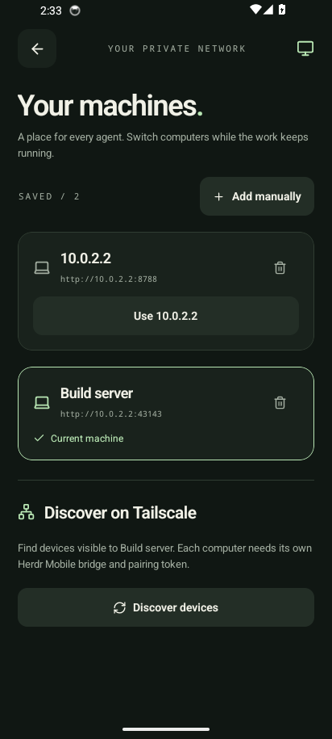
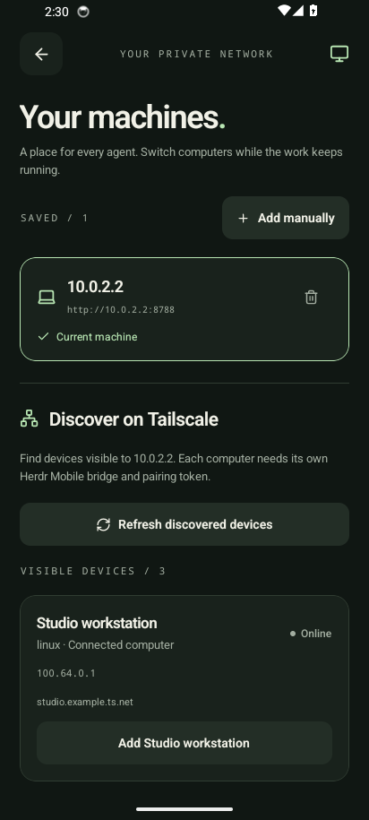

# Verification — October 15, 2026

## Version 0.3.0: terminal reading, keyboard and dictation

- Lint, TypeScript and 63 tests pass, including new suites for paused-output line counting (`terminal.ts`) and dictation text/language helpers (`dictation.ts`). Expo Doctor: 20/21; the config-schema check could not reach exp.host from this machine.
- Release APK (arm64-v8a + x86_64) installed over the previous build on the `herdr-mobile-test` emulator, paired with a disposable named Herdr session and its own test bridge. A dummy "codex" process printed a line every 0.5s; no prompts or keys were sent and no AI provider was called.
- Reading while working: scrolling up showed PAUSED; the visible lines stayed identical across polls while the pill counted new lines accurately. The pill and swiping to the bottom both resumed LIVE following. Recent/Screen switching reset to the latest output.
- Keyboard: with edge-to-edge Android, `padding` placed the composer and key row directly above the keyboard (no nav-bar gap) in Prompt and Type modes; the header and last terminal lines stayed visible, and no padding remained after dismissal.
- Dictation: microphone permission prompt, remembered EN/PT choice, listening state and stop all worked. The emulator's engine reported only `en-US` installed and no `pt-BR` support, which produced the unsupported-language message. A user stop that Android reports as a client error is now silent. Actual speech transcription in English and pt-BR still needs a physical-phone check.

## Version 0.2.0: Tailscale machines

- Lint, TypeScript and the complete automated suite pass: 49 tests. Coverage now includes safe Tailscale field projection, offline/self peers, invalid inventories, caching and CLI failure handling; authentication before discovery; per-profile credentials, origin deduplication, v1 migration, byte/count limits, interrupted saves/removals and serialized writes.
- Expo Doctor: 21/21 checks from the mobile workspace.
- Local live discovery and the updated bridge query returned the expected visible devices. Only the declared peer fields were returned; no other machine was contacted or controlled.
- Built Android version 0.2.0 / code 2. Its signing certificate matches 0.1.0.
- Installed over the existing 0.1.0 emulator app without clearing data. The saved v1 connection migrated and connected without re-entering a token.
- Native discovery displayed three isolated test devices, including an offline peer. Selecting a peer prefilled its private address.
- Added a second local test bridge with a different token; the app verified it, saved it and selected it.
- Both test bridges intentionally exposed `w1:p1`. The app loaded only Build output on one host and Studio output after switching back. Saved-profile removal preserved the remaining host, and force-stop/relaunch retained the selection.
- Independent review found one migration edge for long hostnames; a regression test failed before the generated-display-name fix and passed afterward.
- Android system Back initially exited from a detail screen. Disabled predictive-back mode for this stack and added a focused home-back handler. The final installed APK passed hardware Back checks from agent detail and Machines, and removal of the last profile returned to initial pairing.

All native multi-host checks use controlled local fixtures. Physical phone connectivity to other tailnet hosts remains a device setup check. Each actual host requires its own bridge/token and a phone-accessible tailnet ACL.

## Version 0.1.0 baseline

- `npm run lint:fix`, `npm run typecheck`, `npm test`, `npm run format:check`: passed. 25 automated tests across socket transport, authenticated GraphQL and connection validation.
- Repeated TypeScript/tests/live integration under Node 22.23.3: passed.
- `npx expo-doctor`: 21/21 checks passed after pinning/deduplicating React and Expo-compatible native peers.
- `npm run export:android -w mobile`: Android Hermes bundle exported successfully.
- Live GraphQL integration against installed Herdr 0.9.4 / protocol 22: a uniquely named disposable server accepted snapshot, literal terminal text, Enter, and returned the expected output. The integration script stops only its own server.
- `ANDROID_ARCHITECTURES=arm64-v8a,x86_64 npm run build:android`: successful, 879 Gradle tasks. Standalone APK: `artifacts/herdr-mobile.apk`, approximately 65 MiB.
- Android package `dev.herdr.mobile`, version 0.1.0, min API 24, target API 36; APK signature verified with apksigner.
- Installed and launched the release-mode APK on an Android 14 emulator at phone dimensions. No React Native JS or Android Runtime errors were logged.
- Native app paired with an authenticated localhost test bridge through the emulator host interface; it listed the test agent and loaded terminal output.
- Submitted a prompt through the actual app, observed its delivery acknowledgment and the echoed reply through Herdr's agent API.
- Force-stop/relaunch restored the connection from Expo SecureStore.
- Stopping the test bridge displayed an offline banner while retaining readable output. Restart + refresh recovered current output.
- No prompts, keys, startup actions or shutdown requests were sent to the user's existing agents. The test agent was a controlled echo process recognized as codex in a separate test session; no real AI provider was called.

The host's real bridge is available through its Tailscale interface. Physical-phone installation and reachability through the phone's tailnet were not tested. The phone must have Tailscale enabled and permission to reach TCP 8787.

Independent review found no critical or important issues. Two minor polling observations are recorded in [review.md](review.md).

## Screenshots

These screenshots contain only the isolated test environment.

| Connect                        | Agents                       | Terminal                      |
| ------------------------------ | ---------------------------- | ----------------------------- |
|  |  |  |
