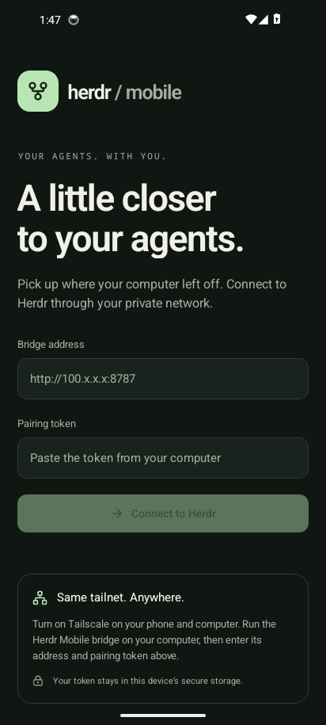
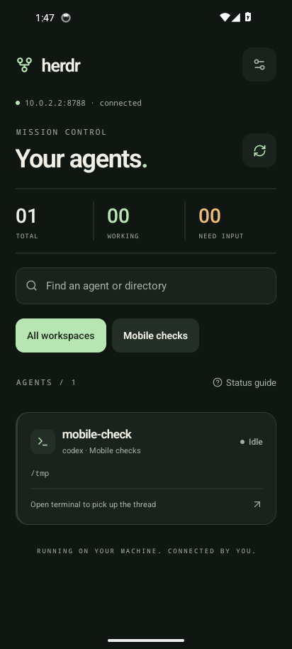
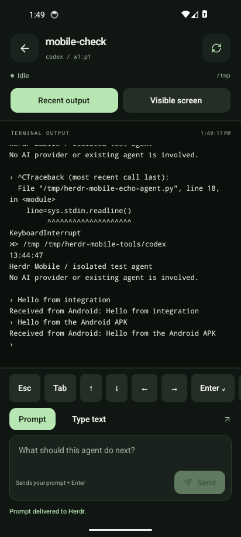

# Verification — October 15, 2026

- `npm run lint:fix`, `npm run typecheck`, `npm test`, `npm run format:check`: passed. 25 automated tests across socket transport, authenticated GraphQL and connection validation.
- Repeated TypeScript/tests/live integration under Node 22.23.3: passed.
- `npx expo-doctor`: 21/21 checks passed after pinning/deduplicating React and Expo-compatible native peers.
- `npm run export:android -w mobile`: Android Hermes bundle exported successfully.
- Live GraphQL integration against installed Herdr 0.9.4 / protocol 22: a uniquely named disposable server accepted snapshot, literal terminal text, Enter, and returned the expected output. The integration script stops only its own server.
- `ANDROID_ARCHITECTURES=arm64-v8a,x86_64 npm run build:android`: successful, 879 Gradle tasks. Standalone APK: `artifacts/herdr-mobile.apk`, approximately 65 MiB.
- Android package `dev.herdr.mobile`, version 0.1.0, min API 24, target API 36; APK signature verified with apksigner.
- Installed and launched the release-mode APK on an Android 14 emulator at phone dimensions. No React Native JS or Android Runtime errors were logged.
- Native app paired with an authenticated localhost test bridge through the emulator host interface; it listed the test agent and loaded terminal output.
- Submitted a prompt through the actual app, observed its delivery acknowledgment and the echoed reply through Herdr's agent API.
- Force-stop/relaunch restored the connection from Expo SecureStore.
- Stopping the test bridge displayed an offline banner while retaining readable output. Restart + refresh recovered current output.
- No prompts, keys, startup actions or shutdown requests were sent to the user's existing agents. The test agent was a controlled echo process recognized as codex in a separate test session; no real AI provider was called.

The host's real bridge is available through its Tailscale interface. Physical-phone installation and reachability through the phone's tailnet were not tested. The phone must have Tailscale enabled and permission to reach TCP 8787.

Independent review found no critical or important issues. Two minor polling observations are recorded in [review.md](review.md).

## Screenshots

These screenshots contain only the isolated test environment.

| Connect                        | Agents                       | Terminal                      |
| ------------------------------ | ---------------------------- | ----------------------------- |
|  |  |  |
